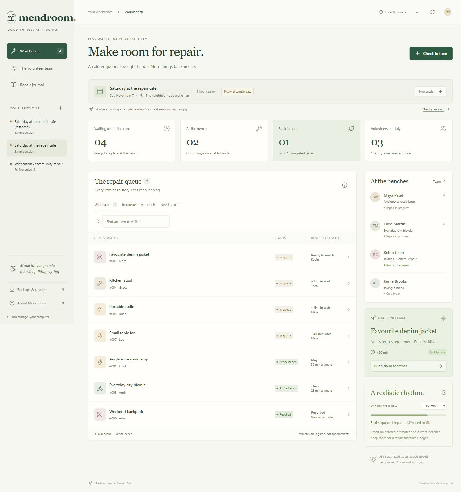

# Mendroom

**A little care. A longer life.**

[](https://github.com/ZephyrusZorro/mendroom/actions/workflows/ci.yml)


A free, local-first workbench for community repair events. Welcome a visitor, give their item a place in a fair queue, find a volunteer with the right skills, and keep a useful record of what happened.

**No account, API key, AI subscription or hosted visitor database.** React + TypeScript, Express, Zod, and a real SQLite database on your computer.



## Why this exists

The welcome desk at a repair event has a deceptively complicated job: knowing who is free, matching skills, watching the queue, and passing on what was learned. [Organiser guidance](https://shareandrepair.scot/wp-content/uploads/2023/08/Guide-to-Setting-Up-a-Repair-Project.pdf) describes those responsibilities explicitly. [Repair Café recorded over 37,000 repairs in 2024](https://www.repaircafe.org/en/category/repairmonitor-en/).

[Repair Connects](https://www.repairconnects.org/) and [Lend Engine](https://www.lend-engine.com/features/repair-cafes) are existing alternatives. Mendroom focuses on a small, self-contained event-day workbench with transparent matching and local data ownership. Adoption and time savings have not yet been validated with organisers.

## Start in a few minutes

Install **Node.js 24 LTS**. From this project folder:

```sh
npm ci
npm run build
npm start
```

Open **[http://127.0.0.1:4317](http://127.0.0.1:4317)**. Keep the terminal open; press Ctrl+C to stop.

On Windows, run **`start-mendroom.cmd`** for dependency setup, build and startup. Internet is needed for initial package installation; the app has no runtime external API or asset dependencies.

Development: `npm run dev`. Full verification: `npm run check`.

## Your first repair session

1. **Create a session.** Enter a name, date, venue and duration. Real sessions start empty; the optional sample is clearly labelled fictional.
2. **Gather your team.** Add volunteers and skills. Taking a break pauses new matching while allowing an existing repair to finish.
3. **Check in an item.** A visitor's first name or alias is enough. Enter the problem, skill and estimated bench time. A coordinator review hold blocks assignment until a review note is recorded.
4. **Bring the right people together.** Open an item or use the next-match suggestion. The server enforces skills, availability and one active repair per volunteer.
5. **Record what happened.** Save a repaired or not-repaired outcome with notes. Record missing parts, then return the ticket to the end of the queue when parts arrive. Follow-up notes work in every state.
6. **Keep the useful details.** Revisit the journal, print a take-home record, export CSV, or download a portable session backup.

On phones, choose a session below the navigation. The download icon opens backups and reports.

## Features

- **Explainable queue:** intake order, selected skills, current availability and entered bench-time estimates. No opaque score or AI diagnosis.
- **Capacity planning:** choose a window from now to see which queued repairs are estimated to fit. Overrunning work retains a five-minute buffer. These are estimates, not appointments.
- **Durable records:** transactional SQLite writes, activity history and revision conflicts instead of silent overwrites.
- **Parts follow-up:** record sourcing details, release the volunteer and rejoin fairly with the original ticket number.
- **Portable data:** validated JSON backups, separate restored copies, spreadsheet-safe CSV and printable records with event identity.
- **Responsive interface:** desktop and phone layouts, keyboard focus, native dialogs, reduced motion, useful empty states and recoverable errors.

## Data and backups

The database is **`data/mendroom.sqlite`**, with SQLite WAL sidecars while running. The whole `data/` folder is ignored by Git. Data is **not encrypted**; use your computer's normal account and disk protections.

Download each session from **Backups & reports → Download session backup**. Restore creates a separate session at the top of your list, preserving the exact title, sample label, records and history. IDs are remapped and existing sessions stay intact. Identical titles after restore are expected. CSV is a report, not a restorable backup.

Each session supports **250 volunteers, 2,000 tickets, 10,000 activity entries, 20,000 note characters per ticket and an 8 MiB archive budget**. A conservative UTF-8 storage budget reserves room for the export envelope. Changes exceeding a limit roll back with an explanation; export and start a fresh session. Ordinary mutations have a 64 KiB payload limit; restore alone accepts 8 MiB.

For a raw database copy, stop the app first. Prefer JSON backups when moving sessions between computers. Exports contain visitor aliases and notes; keep them private.

## Configuration

No configuration is required. `.env.example` documents optional environment variables; `.env` is not loaded automatically. PowerShell example:

```powershell
$env:PORT = '4319'
$env:MENDROOM_DB = 'data/another-workspace.sqlite'
npm start
```

Then open `http://127.0.0.1:4319`. The server always binds to **127.0.0.1**. This edition is for one trusted local coordinator, with no remote login or network sharing. Do not expose it through a public proxy.

## Engineering and verification

```sh
npm run typecheck
npm test
npm run build
npm audit --omit=dev
```

**16 automated tests** exercise the real database and HTTP boundaries: repair lifecycle, persistence, assignments, holds, stale edits, parts transitions, matching, backup references, safe CSV, large-archive restore, UTF-8 capacity rollback, repeated full restores, injected write failure, remembered-session recovery and record identity.

GitHub Actions runs a clean install, typecheck, tests, production build and production-dependency audit on **Windows and Ubuntu with Node 24**. See the [verification record](docs/verification.md) for browser checks and evidence boundaries.

```text
React workbench → same-origin Express API → transactional SQLite store
        shared TypeScript schemas, limits and queue projection
```

`shared/` holds contracts and algorithms; `server/` owns persistence, request protections and portability; `src/` contains the workbench, volunteer roster and journal; `tests/` covers domain, integration and release regressions.

The six delivery milestones were pushed as the work was built. Databases and private exports are excluded. [Product brief](docs/product.md) · [Research](docs/research.md) · [Plan](docs/plan.md) · [Execution record](docs/progress.md).

## Practical limits and next steps

This is a tested local release, not a hosted multi-user service. Node 24's SQLite API is experimental; the Node major is constrained and persistence is exercised in tests. Queue times depend on entered estimates. Actual printer output, screen-reader accessibility, live-event adoption and production hosting have not been verified. Mendroom coordinates work; it does not certify item safety or provide repair instructions.

The three most valuable next steps are:

1. **Pilot with organisers:** measure intake friction, missed handovers and estimate accuracy at real events.
2. **Optional shared event access:** add real identity, per-event permissions, concurrency testing and managed backups before hosting.
3. **Better handovers:** multilingual records, QR ticket lookup and tested repair-reporting integrations.

The source is public. Community centres, libraries, repair cafés and volunteer reuse projects are the intended pilot users. A hosted edition should follow the access, data-protection and operating checks above.

## License

[MIT](LICENSE).
